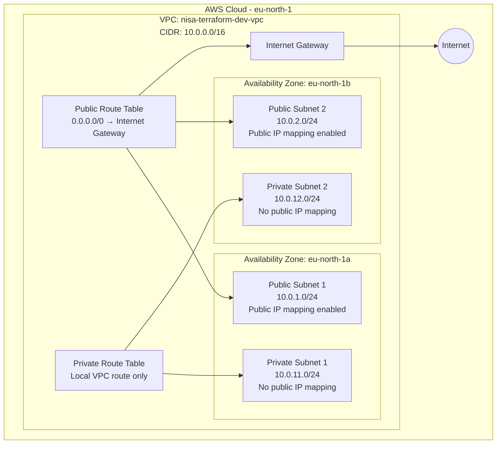

# NISA Technology — AWS Infrastructure with Terraform


## Project Overview

This project provisions a reusable AWS network infrastructure using **Terraform**.

It demonstrates Infrastructure as Code (IaC), modular Terraform design, AWS networking fundamentals, resource tagging, input validation, infrastructure planning, and automated CI validation.

The initial implementation focuses on building a Virtual Private Cloud (VPC) with public and private subnets distributed across two Availability Zones.

**Project owner:** NISA Technology
**Environment:** Development
**AWS Region:** `eu-north-1` (Stockholm)

## Architecture

The planned infrastructure consists of:

- One AWS VPC.
- Two public subnets across two Availability Zones.
- Two private subnets across the same Availability Zones.
- One Internet Gateway.
- A public route table with an internet route.
- A private route table without a direct internet route.
- Route table associations for all four subnets.

### Network Architecture Diagram

The following diagram represents the current Terraform configuration.



**Architecture notes:**

- Public subnets use a shared route table with a default route to the Internet Gateway.
- Private subnets use a separate route table with only the automatic local VPC route.
- Private subnets do not have a NAT Gateway or direct internet route.
- Public IP mapping is enabled for public subnets and disabled for private subnets.
- Public IP mapping alone does not guarantee that a workload is reachable from the internet; routing and security rules also matter.

### IP Address Allocation

| Component | CIDR Block | Availability Zone |
|---|---|---|
| VPC | `10.0.0.0/16` | eu-north-1 |
| Public Subnet 1 | `10.0.1.0/24` | eu-north-1a |
| Public Subnet 2 | `10.0.2.0/24` | eu-north-1b |
| Private Subnet 1 | `10.0.11.0/24` | eu-north-1a |
| Private Subnet 2 | `10.0.12.0/24` | eu-north-1b |

## Repository Structure

```text
terraform-aws-infrastructure/
├── .github/
│   └── workflows/
│       └── terraform.yml
├── environments/
│   └── dev/
├── modules/
│   └── network/
│       ├── main.tf
│       ├── variables.tf
│       └── outputs.tf
├── main.tf
├── README.md
├── .gitignore
└── .terraform.lock.hcl
```

The root configuration defines the AWS provider and calls the reusable network module.

The network module manages the VPC, subnets, Internet Gateway, route tables, routes, and subnet associations.

The `.github/workflows/terraform.yml` file defines the GitHub Actions CI workflow.

The `environments/dev` directory is reserved for a future environment-specific configuration.

## Technologies Used

- **AWS:** Cloud infrastructure provider.
- **Terraform:** Infrastructure as Code.
- **AWS CLI:** AWS authentication and account access.
- **HCL:** Terraform configuration language.
- **Git:** Version control.
- **GitHub:** Source code hosting and collaboration.
- **GitHub Actions:** Continuous Integration and automated validation.

## Prerequisites

Before deploying, ensure you have:

1. An AWS account with appropriate permissions.
2. AWS CLI installed and authenticated.
3. Terraform installed.
4. Git installed.

This project currently uses the following versions:

| Tool | Version |
|---|---|
| Terraform | 1.17.0 |
| AWS Provider | 6.70.0 |
| AWS CLI | 2.38.5 |

## AWS Authentication

The project uses an AWS CLI profile named `terraform-dev`.

Authenticate using your configured AWS login method and verify your identity:

```bash
aws sts get-caller-identity --profile terraform-dev
```

The AWS provider is configured to use this profile and the `eu-north-1` region.

Avoid committing AWS credentials, access keys, private keys, or other secrets to the repository.

## Getting Started

Clone the repository:

```bash
git clone https://github.com/bukummy8/terraform-aws-infrastructure.git
cd terraform-aws-infrastructure
```

Initialize Terraform:

```bash
terraform init
```

Format the configuration:

```bash
terraform fmt -recursive
```

Validate the configuration:

```bash
terraform validate
```

Generate an execution plan:

```bash
terraform plan -out=tfplan
```

Review the saved plan:

```bash
terraform show -no-color tfplan
```

Only apply the infrastructure after reviewing the plan and confirming the expected AWS resources and costs:

```bash
terraform apply tfplan
```

**Note:** The commands above describe the deployment workflow. The infrastructure in this project is currently planned but has not yet been deployed.

## Terraform Module Features

The network module supports:

- Configurable VPC CIDR.
- Configurable Availability Zones.
- Configurable public and private subnet CIDRs.
- Configurable environment names.
- Common resource tags.
- Input validation for network names, IPv4 CIDR syntax, Availability Zone uniqueness, minimum Availability Zone count, and subnet count matching.
- A validation resource that checks for duplicate subnet CIDR entries.
- Outputs for VPC ID, subnet IDs, and Internet Gateway ID.

## Resource Tagging

Resources receive consistent tags to support identification and cost allocation.

| Tag | Value |
|---|---|
| Project | terraform-aws-infrastructure |
| Environment | dev |
| Owner | NISA Technology |
| ManagedBy | Terraform |

## Continuous Integration

This repository uses **GitHub Actions** to automate Terraform checks.

The workflow is located at:

`.github/workflows/terraform.yml`

It runs automatically when code is pushed to the `main` branch or a pull request targets `main`.

The workflow performs the following checks:

1. Checks out the repository.
2. Sets up Terraform 1.17.0.
3. Checks Terraform formatting.
4. Initializes Terraform without configuring a backend.
5. Validates the Terraform configuration.

The workflow does not deploy AWS infrastructure or require AWS credentials.

**Workflow status:**

[](https://github.com/bukummy8/terraform-aws-infrastructure/actions/workflows/terraform.yml)

## Security Considerations

Security is an important part of this infrastructure design.

Current design decisions:

- Public and private subnets are separated.
- Private subnets have no direct route to the Internet Gateway.
- Private subnets do not automatically assign public IPv4 addresses.
- AWS credentials are managed outside the Terraform configuration.
- Terraform state and local plan files should not be committed to Git.

The current implementation does not yet include custom security groups, VPC Flow Logs, private connectivity endpoints, or application workloads. These are potential future improvements.

## Cost Considerations

The project intentionally excludes a NAT Gateway in the initial implementation to avoid its hourly and data-processing charges.

However, AWS public IPv4 addresses, data transfer, and future application resources can incur charges.

Review AWS pricing and the expected costs before deploying additional resources.

## Cleanup

After deployment, review the resources that Terraform plans to destroy:

```bash
terraform plan -destroy
```

If the proposed destruction is correct and you intend to remove the infrastructure:

```bash
terraform destroy
```

Do not delete infrastructure until you have confirmed that no workloads or data depend on it.

## Future Improvements

Planned enhancements include:

- Stronger CIDR validation and subnet overlap protection.
- Environment-specific configurations for development, staging, and production.
- Custom security groups and least-privilege network access.
- NAT Gateway as an optional feature.
- VPC Flow Logs and network monitoring.
- Remote Terraform state management with encryption and state locking.
- Automated Terraform security scanning.
- Deployment of an application workload to demonstrate the network.

## Project Status

**Current stage:** Network module development, architecture verification, documentation, and GitHub Actions CI integration.

The current Terraform execution plan proposes **13 AWS resources and 1 Terraform validation resource**, for a total of 14 Terraform resources.

The plan contains no changes or deletions.

**No infrastructure has been applied to AWS yet.**

---

Built by **NISA Technology** — Infrastructure as Code, Cloud & DevOps.

GitHub: https://github.com/bukummy8/terraform-aws-infrastructure
